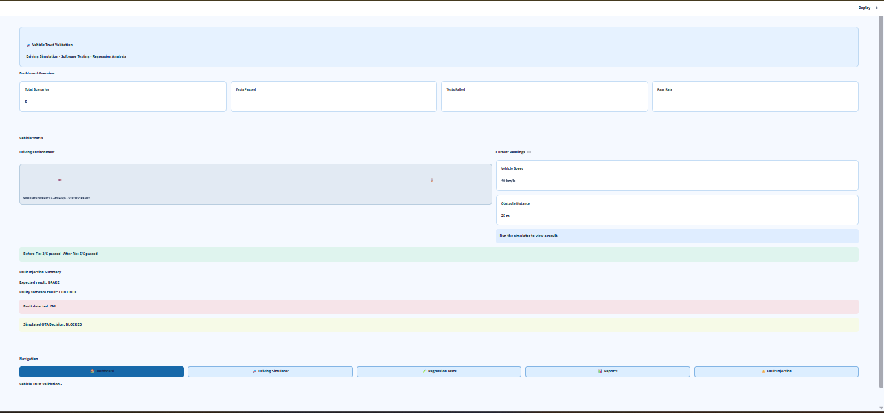

# Vehicle Trust Validation

A Python-based simulation and regression testing project designed to validate safety-critical behaviour in Software-Defined Vehicles (SDVs).

The project simulates vehicle driving scenarios, evaluates safety responses, performs regression testing, injects faults, and compares test results to support software update validation.

## 🚗 Key Features

- **Driving Simulator** – Simulate vehicle speed, obstacle distance, and missing sensor data.
- **Automated Regression Testing** – Execute predefined scenarios and evaluate expected versus actual results.
- **Fault Injection** – Simulate faults to examine vehicle safety behaviour.
- **Test Coverage** – Review the available validation scenarios.
- **Before vs After Comparison** – Compare baseline and updated software test results.
- **Regression History** – View previously saved test results.
- **Visual Reports** – Review regression comparison tables and pass/fail charts.
- **CSV Export** – Download regression test reports.
- **OTA Trust Score** – Display a simulated trust score and update readiness status.

## 🧪 Test Scenarios

The project includes the following scenarios:

1. Emergency Braking
2. Sudden Obstacle Detection
3. Missing Sensor Data
4. Invalid Negative Distance
5. Clear Road

Each scenario helps evaluate the vehicle software's response under different simulated conditions.

## 🛠️ Technologies Used

- Python
- Streamlit
- Pandas
- Automated Regression Testing
- Fault Injection
- Git and GitHub

## 📸 Dashboard Preview



## ⚙️ Installation and Setup

### 1. Clone the repository

```bash
git clone https://github.com/Poojukutty/VehicleTrustValidation.git
```

### 2. Navigate to the project directory

```bash
cd VehicleTrustValidation
```

### 3. Install dependencies

```bash
python -m pip install -r requirements.txt
```

### 4. Run the application

```bash
python -m streamlit run app.py
```

The application will open in your browser using the local Streamlit server address.

## 📊 Project Workflow

1. Select or run a vehicle simulation scenario.
2. Evaluate expected and actual vehicle responses.
3. Execute regression tests.
4. Review test history and before/after comparisons.
5. Analyse the regression pass/fail chart.
6. Download test reports as CSV.
7. Review the simulated OTA Trust Score and readiness status.

## 🔮 Future Enhancements

- Integration with a driving simulator.
- Additional safety validation scenarios.
- More detailed regression reports and visualisations.
- Enhanced fault detection and safety validation.

## ⚠️ Disclaimer

This project is an educational prototype for software testing and vehicle safety validation concepts. It is not certified for use in real vehicles or production automotive systems.

## 👩‍💻 Author

**Pooja Karthikeyan**  
B.Tech Information Technology
